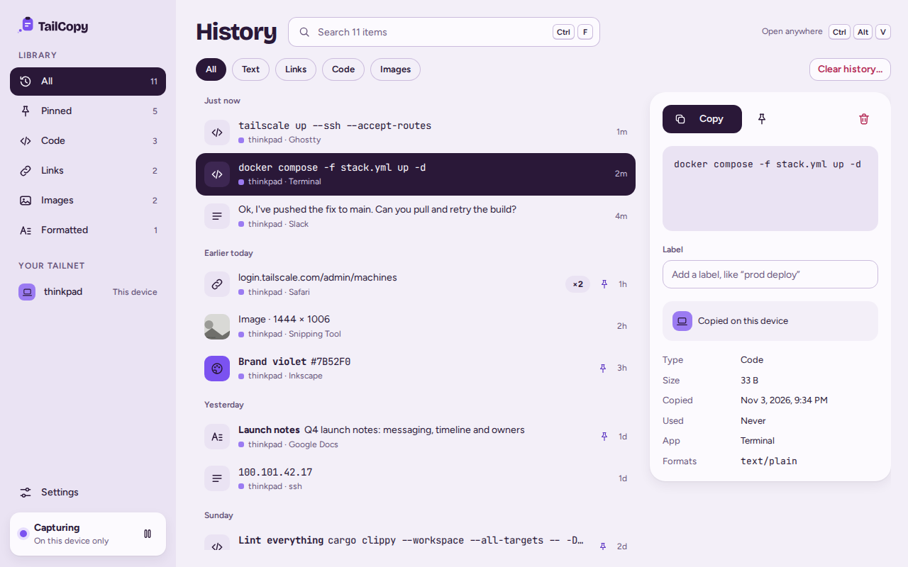
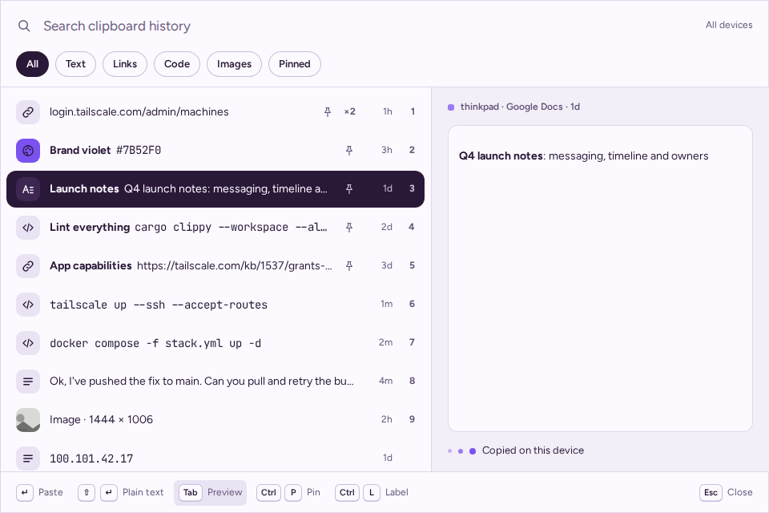
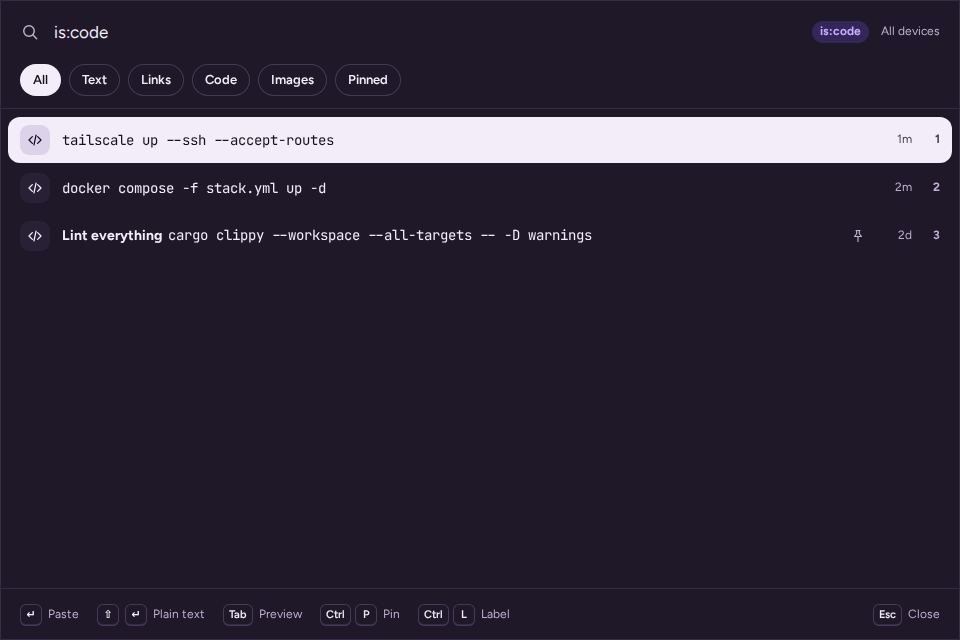
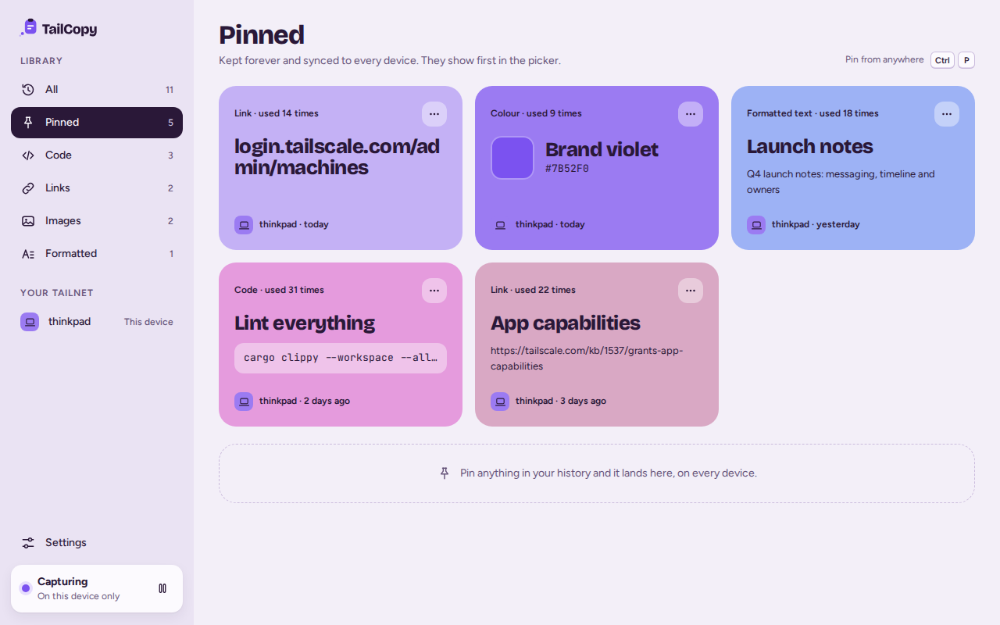
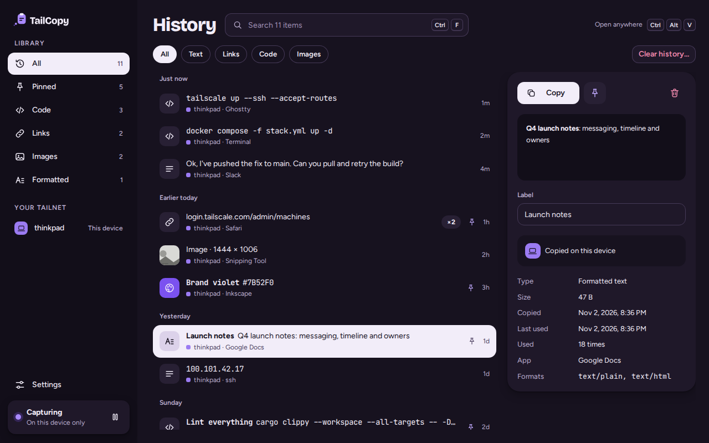

<p align="center">
  <picture>
    <source media="(prefers-color-scheme: dark)" srcset="design/assets/logo/lockup-dark.svg">
    <source media="(prefers-color-scheme: light)" srcset="design/assets/logo/lockup.svg">
    
  </picture>
</p>

<p align="center">
  <strong>Your clipboard history, one shortcut away, on every device you own.</strong><br>
  A keyboard-first clipboard manager for Windows, macOS and Ubuntu that syncs over your
  own <a href="https://tailscale.com">Tailscale</a> tailnet.<br>
  No account, no cloud, no tracking.
</p>

<p align="center">
  <a href="https://github.com/moorew/tailcopy/releases/latest"><strong>Download</strong></a>
  ·
  <a href="#getting-started">Getting started</a>
  ·
  <a href="#sync">How sync works</a>
  ·
  <a href="#privacy">Privacy</a>
</p>



## Why TailCopy

- **Find anything you copied.** Press your shortcut over any app, type a few letters,
  press Enter, and it pastes straight into the app you were using.
- **Copy on one machine, paste on another.** Every device signed in to your Tailscale
  account shares one history. Devices talk to each other directly; nothing goes through
  a server, because there isn't one.
- **Private by default.** Passwords and anything else apps mark as secret are never
  saved, so they never sync either.
- **Works where others don't.** That includes GNOME on Wayland, where a small GNOME Shell
  extension that comes with the app makes the shortcut and paste work.

<table>
  <tr>
    <td></td>
    <td></td>
  </tr>
  <tr>
    <td></td>
    <td></td>
  </tr>
</table>

## Getting started

1. **Download** the installer for your system from the
   [latest release](https://github.com/moorew/tailcopy/releases/latest).
2. **Install it and open TailCopy.** A short setup picks your shortcut and asks for
   anything your system needs. Nothing needs a terminal.
3. **For sync,** install TailCopy on your other devices too, with Tailscale running and
   signed in to the same account on each. They find each other within a few seconds.

| System | Download | Notes |
| --- | --- | --- |
| Windows 10 (22H2) and 11, x64 | `TailCopy-…-windows-x64-setup.exe` | Installs for your user only. The installer isn't code-signed yet, so SmartScreen asks first: choose **More info**, then **Run anyway**. |
| macOS 13 Ventura and later (Apple silicon and Intel) | `TailCopy-…-macos-universal.dmg` | Signed and notarized. Drag TailCopy to Applications. Setup asks for Accessibility so TailCopy can paste for you, with a button that opens the right settings pane. |
| Ubuntu 24.04 and 26.04 (GNOME on Wayland) | `TailCopy-…-ubuntu-amd64.deb` | Open it with App Center, or run `sudo apt install ./TailCopy-…deb`. Setup turns on the GNOME extension. GNOME needs you to log out and back in once, and setup has a button for that. |

Each release has a `SHA256SUMS` file to check the downloads against.

You don't need Tailscale to use TailCopy: without it, TailCopy keeps your history on the
device you're using.

## Using it

| Keys (⌘ instead of Ctrl on macOS) | What it does |
| --- | --- |
| **Ctrl+Alt+V** (macOS **⌘⇧V**) | Open the picker over any app. You can change this in Settings > Shortcuts. |
| Type | Search |
| ↑ ↓ | Move through the list |
| Enter / Shift+Enter | Paste / paste as plain text |
| Ctrl+1 to Ctrl+9 | Paste that row |
| Tab | Show the preview |
| Ctrl+P / Ctrl+L | Pin / add a label |
| Ctrl+Shift+Backspace | Delete |
| Ctrl+C | Copy without pasting |
| Esc | Clear the search, then close |

TailCopy lives in the system tray (the menu bar on macOS). From there you can open the
History window, pause capturing, open Settings or quit.

### Features

- **Text, formatted text and images:** HTML and RTF keep their formatting when you
  paste. Shift+Enter pastes anything as plain text.
- **Search** uses fuzzy matching on contents and labels. These filters narrow it down:
  `is:pinned`, `is:text`, `is:rich`, `is:image`, `is:code`, `is:link`, `today` and
  `yesterday`.
- **Smart types:** links, code and shell commands, colours and IP addresses get their
  own icons. Code is shown in a monospace font.
- **Pins and labels:** pinned items are kept forever and come first in the picker. A
  label ("prod deploy") makes an item easy to find again.
- **History window:** counts by type, items grouped by time, and a detail view.
  **Undo** is available for 5 seconds after you delete.
- **Pause** capturing for 15 minutes, an hour, or until you resume.
- **Light and dark,** following your system.
- **Command line:**
  - The commands are `tailcopy picker`, `tailcopy paste-plain`, `tailcopy pause`,
    `tailcopy resume` and `tailcopy status`.
  - On Ubuntu `tailcopy` is on your path. On Windows and macOS it's the app's own binary.
  - `tailcopy picker` can be bound to a key in any launcher.

When "Paste for me" is off, or a window won't accept a pasted keystroke (an app running
as administrator on Windows), choosing an item copies it and TailCopy tells you to press
Ctrl+V.

## Sync

- **Only your devices.** TailCopy listens only on your Tailscale addresses and checks
  every connection with Tailscale before it reads anything. Only untagged devices
  signed in to *your* Tailscale login can sync. Anyone else on a shared tailnet is
  refused, even if the tailnet policy allows everything.
- **Live.** Copy on one device and a moment later it's in the picker on the others,
  ready to paste. Something you copied more recently is never overwritten.
- **Catches up.** A device that was asleep or off gets everything it missed, in order,
  when it's back. Devices pass along what they got from each other, so two devices that
  can't reach each other directly still sync through a third. Pins, labels, deletes and
  clears sync too.
- **You choose.**
  - Settings > Tailnet lists your devices and how each is connected.
  - Each device has **Send** and **Receive** switches.
  - Images up to 10 MB sync. You can change that limit or turn images off.
- **What stays put:** passwords and secrets (never stored), apps you mark "keep on this
  device", and images over the limit.

TailCopy uses TCP port 7441 inside your tailnet. If your tailnet policy isn't allow-all,
allow your devices to reach each other on `tcp:7441`.

On Windows, the first time sync starts, Windows Firewall may ask whether TailCopy can
accept connections. **Allow it on private networks.** If you don't, that PC still syncs
by connecting out to your other devices, but two PCs that both refused can't connect to
each other directly.

## Privacy

- **No accounts, no servers, no analytics, no crash reports, no update checks.** Your
  clips go only to your own devices, over your tailnet.
- **Secret copies are skipped.** That covers:
  - Windows' "exclude from history" flag
  - macOS concealed and transient types
  - the password-manager hints KeePassXC and others set on Linux

  1Password, Bitwarden, KeePassXC and Proton Pass are also ignored by app name. You can
  ignore any other app, or keep its copies on the device they were made on.
- **Logs never contain anything you copied.** Settings > About > Copy diagnostics gives
  you a summary you can safely attach to a bug report.
- **History is kept for 1,000 items or 30 days,** whichever is smaller. Pinned items
  are kept regardless. Change this in Settings > History and storage.

| System | Settings (`config.toml`) | History and logs |
| --- | --- | --- |
| Windows | `%APPDATA%\moorew\TailCopy\config` | `%LOCALAPPDATA%\moorew\TailCopy\data` |
| macOS | `~/Library/Application Support/io.github.moorew.TailCopy` | the same folder |
| Linux | `~/.config/tailcopy` | `~/.local/share/tailcopy` |

## Status and known issues

TailCopy is young: version 0.2, tested on Windows, macOS and Ubuntu, with sync tested between Windows and Ubuntu machines.

- **Ubuntu:** clips that arrive from another device go on the clipboard as plain text or
  an image. Paste them from the picker to keep their formatting.
- **Send and Receive:** turning either back on doesn't bring across clips made while it
  was off.
- **Uninstalling on Ubuntu:** the package is named `tail-copy`, so use
  `sudo apt remove tail-copy`.

Found a bug, or something that went missing or arrived twice?
[Open an issue](https://github.com/moorew/tailcopy/issues). Include the text from
Settings > About > Copy diagnostics, which never contains anything you copied.

**Coming next:**
- an optional self-hosted relay, so devices catch up even while your others are off
- signed updates
- a listing on extensions.gnome.org

The full plan is in [SPEC.md](SPEC.md).

## Building from source

You need:
- Rust (stable)
- Node 22
- on Linux, these packages: `libwebkit2gtk-4.1-dev libayatana-appindicator3-dev librsvg2-dev libxdo-dev`

```sh
cd app && npm ci && npm run build   # the front end, embedded into the app
cargo test --workspace
cd app && npx tauri dev             # run it
cd app && npx tauri build           # make an installer for this system
```

On GNOME, a development build has to be allowed by the extension first; see
[CLAUDE.md](CLAUDE.md) ("GNOME notes").

The code is laid out as follows:
- `crates/`: the core store, sync, the Tailscale adapter and platform code
- `app/`: the Tauri shell and the Svelte UI
- `extension/`: the GNOME Shell extension
- [`design/`](design/HANDOFF.md): design tokens, fonts, icons and the brand

## Licence

The app is MIT or Apache-2.0, at your option ([LICENSE-MIT](LICENSE-MIT),
[LICENSE-APACHE](LICENSE-APACHE)). The GNOME extension in `extension/` is
GPL-2.0-or-later. The fonts (Bricolage Grotesque, Figtree and JetBrains Mono) are under
the SIL Open Font License (`design/fonts/`).

TailCopy is an independent project built on Tailscale. It isn't made by or affiliated
with Tailscale Inc.
